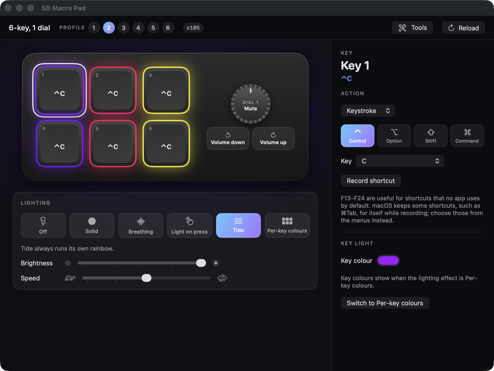

# SD Macro Pad

A Mac app for those cheap little RGB macro pads off Temu and AliExpress: the ones that show up
on USB as **SDINNOVATION SIDE-KEYBOARD** and come with a leaflet pointing at download links
that died years ago.

I bought two of them, a 6-key with a dial and a 16-key with three dials. Out of the box every
key typed Ctrl+A, the lights did a rainbow I couldn't turn off, and there was no software to be
found. So I worked out how they talk and wrote my own.



## What it does

- **Remap every key and dial.** Shortcuts (there's a recorder), media keys, mouse clicks and
  scrolling, sleep/power, or nothing at all. Each dial has three actions: press, clockwise and
  anticlockwise.
- **Lighting.** Off, solid, breathing, light-on-press, the "tide" rainbow, or a colour per key.
- **Six profiles**, each with its own key map.
- **Macros.** Sixteen of them, stored on the pad: a line of text, or a string of shortcuts.
- **Tools.** A diagnostics dump, a key tester, a raw command console, and firmware backup and
  flashing.

Everything is saved on the pad itself. Set it up once and it works on any machine, with or
without the app running.

## Download

Grab the latest build from [Releases](../../releases). It's signed and notarised, and needs
macOS 13 or later.

## Will it work with my pad?

| Pad | USB ID | Status |
|---|---|---|
| 6 keys + 1 dial | `6D80:DC81` | Works. This is one of mine. |
| 16 keys + 3 dials | `6D7D:DCFC` | Works. This is the other one. |
| 3, 4, 8, 9, 10, 12 and 15-key siblings | `6D7B`–`6D83` | Same family and protocol, so probably, but I don't own them. They show up with a generic layout. |

The catch is firmware. Mine both arrived on an old factory firmware that nothing can
configure, not even the vendor's own tools. The app spots that and tells you. The fix is to
flash the vendor's v105 firmware, which the app can do (Tools ▸ Firmware):

1. Hold the top-left and top-right keys while plugging the pad in. That's bootloader mode.
2. Back up what's on it.
3. Flash the v105 image for your exact model.
4. Replug.

I can't hand out the firmware images because they're the vendor's. The
[technical reference](docs/TECHNICAL_REFERENCE.md) says where they live and gives checksums.
The bootloader never gets overwritten, so a bad flash is recoverable; I know because I managed
several.

## Command line

There's a terminal version too, `sdpad`, built alongside the app:

```bash
sdpad list
sdpad keys
sdpad set 1 cmd+shift+4
sdpad set d1cw media:volup
sdpad light solid --colour "#ff3300"
sdpad colour 3 "#00ffaa"
sdpad macro 1 text "hello"
```

Run `sdpad` on its own for the full list.

## Using the pads in your own software

The app and the CLI both sit on a small Swift library, `SDPadKit`:

```swift
import SDPadKit

let pad = PadMonitor().settle().pads.first!
try pad.writeKey(.key(0), .key(0x68, [.command]))        // key 1 = Cmd+F13
try pad.writeKey(.knob(0, .clockwise), .consumer(0xE9))   // dial = volume up
try pad.writeKeyColour(0, RGB(hex: "#FF0000")!)
```

If Swift isn't your thing, [docs/TECHNICAL_REFERENCE.md](docs/TECHNICAL_REFERENCE.md) has the
whole protocol written out: every command byte, the bootloader, the macro format, and a short
hidapi example. It also marks what I've actually tested on hardware and what I've only read
out of the vendor's code, so you know which bits to trust.

## Building

You need Xcode's Swift toolchain.

```bash
scripts/build-app.sh
```

That builds `SD Macro Pad.app` and `sdpad` into the project folder. It signs with a Developer
ID certificate if you have one, and `--notarize` notarises as well.

## Thanks

Two open-source projects gave me a head start on the protocol:
[Knurl](https://github.com/dozzenn/knurl) and
[MacroPad](https://github.com/ysalitrynskyi/MacroPad). Neither supported my pads as they
shipped, but their notes saved me a lot of guessing.

## Disclaimer

This is my own project and has nothing to do with SDINNOVATION, SDCX or Huali. It comes with
no warranty. Remapping and lighting use the same commands as the vendor's tool, but flashing
firmware is always at your own risk. Back the pad up first.

MIT licensed. See [LICENSE](LICENSE).
